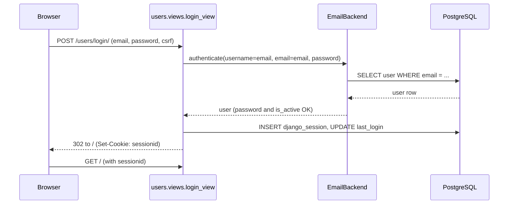

# Hatsu Problem Migrator: Functionality Documentation

This document lets a new engineer follow a user action from the browser, through the backend, to the database or an external service. It describes the code as it is, using real file, function and URL names.

## 1. Overview

The app is a staff-only Django web application. A staff member enters a Polygon problem ID. The app fetches the problem and its test cases from Polygon, then copies them into the app's PostgreSQL database and uploads the full test-case files to cloud storage.

| Part | Technology | Role |
|---|---|---|
| Web app | Django 5.2.3 | Pages, forms, login, admin |
| Database | PostgreSQL | Users, sessions, problems, tags, test cases |
| Cache | Redis | Holds the fetched test cases for 30 minutes so Polygon is not called again |
| External API | Polygon (`https://polygon.codeforces.com/api/`) | Source of the problem, statement, tests and checker |
| File storage | Azure Blob Storage or any S3-compatible service (Supabase, AWS S3, R2, MinIO) | Full input and answer file of every test case |

### 1.1 Repository layout

```
PolygonMigration/                  Django project root (manage.py lives here)
  PolygonMigration/                settings.py, urls.py, wsgi.py, asgi.py
  problems/                        the migrator
    views.py                       index view: handles every button on the main page
    polygon_api.py                 PolygonAPI class: Polygon calls, Redis cache, storage migration
    models.py                      Problem, ProblemTag, SampleTestCase, ProblemTestCase
    storage.py                     storage interface and provider switch (get_storage)
    S3Testcase.py                  S3-compatible storage class (boto3)
    AzureTestcase.py               Azure Blob storage class
    templates/problems/index.html  the page the user sees
  users/                           login and the custom user model
    views.py                       login_view, logout_view
    backends.py                    EmailBackend (log in with email)
    models.py                      custom User (email is the login name)
    templates/users/login.html     the login page
  contents/                        owns the Topic model that User refers to
```

### 1.2 URL map

`PolygonMigration/PolygonMigration/urls.py` routes requests like this:

| URL | Goes to | Notes |
|---|---|---|
| `/` | `problems.urls`, view `problems.views.index` | The migrator page. Staff only |
| `/users/login/` | `users.views.login_view` | URL name `login` |
| `/users/logout/` | `users.views.logout_view` | URL name `logout` |
| `/admin/` | Django admin | Separate login, same users |

### 1.3 Configuration

All secrets and endpoints come from the `.env` file, which `settings.py` reads with `os.getenv`. See `.env.example` for the full list (database, Redis, Polygon key and secret, storage provider).

## 2. Functionality

### 2.1 User flows

---

### Flow 1: User login

**Files:** `users/views.py` (`login_view`, `logout_view`), `users/backends.py` (`EmailBackend`), `users/models.py` (`User`, `UserManager`), `users/templates/users/login.html`, `problems/views.py` (the `@user_passes_test` decorator on `index`), `settings.py` (`AUTH_USER_MODEL`, `AUTHENTICATION_BACKENDS`, `SESSION_COOKIE_AGE`, middleware).

#### 1. What the user clicks or submits

The user opens `http://localhost:8000/`. They are not logged in, so Django sends them to the **Staff Login** page. They type their email and password and click **Login**.

The redirect happens because `index` in `problems/views.py` is wrapped in:

```python
@user_passes_test(lambda u: u.is_authenticated and u.is_staff, login_url='/users/login/')
```

An anonymous request to `/` gets a `302` to `/users/login/?next=/`.

#### 2. What the frontend sends

The login form in `login.html` is a plain HTML `<form method="post">`. It has no JavaScript. It sends one `POST /users/login/` with these fields:

| Field | Source |
|---|---|
| `email` | the Email input (`type="email"`) |
| `password` | the Password input |
| `csrfmiddlewaretoken` | the `` tag, checked by `CsrfViewMiddleware` |

#### 3. What the backend does, in order

`login_view` in `users/views.py`:

1. If the visitor already has a logged-in session, it calls `logout(request)` first. Opening the login page while logged in logs you out.
2. If the request is a `GET`, it renders `users/login.html` and stops.
3. On `POST`, it reads `email` and `password` from `request.POST`.
4. It calls `authenticate(request, username=email, email=email, password=password)`. Django tries each class in `AUTHENTICATION_BACKENDS` in order:
   - `users.backends.EmailBackend.authenticate` looks up one user with `User.objects.get(email=email)`, checks `user.check_password(password)`, and checks `user_can_authenticate` (the account must have `is_active=True`). It returns the user, or `None`.
   - Django's `ModelBackend` is the fallback. The `User` model sets `USERNAME_FIELD = 'email'`, so it also accepts the email as the username.
5. If `authenticate` returns `None`, it adds the message `Invalid email or password.` and re-renders the login page.
6. If a user is found but `user.is_staff` is false, it adds `You do not have staff access.` and re-renders the page.
7. If the user is staff, it calls `login(request, user)`, which creates the session and sets the `sessionid` cookie, then returns `redirect('problems:index')`.

The request then goes to `/`, where the `@user_passes_test` check passes because `is_authenticated` and `is_staff` are both true.

#### 4. External APIs

None. Login only touches the app's own database.

#### 5. What is read or written

| Table | Operation |
|---|---|
| `users_user` | Read: one row by `email`. Written: `last_login` is updated by Django's `login()` |
| `django_session` | Written: one new session row. Sessions live in the database because `settings.py` does not override `SESSION_ENGINE` |

The session lasts one day (`SESSION_COOKIE_AGE = 86400`). Passwords are stored as hashes. `check_password` compares against the hash, and password validators (`AUTH_PASSWORD_VALIDATORS`) only run when a password is created, for example by `createsuperuser`.

#### 6. What the user sees

- **On success:** the browser lands on `/`, the page titled **Hatsu: Problem Migrator**, with the navbar text `Welcome, <first name> <last name>` and a **Logout** button.
- **On failure:** the login page again with a red alert box. The text is either `Invalid email or password.` or `You do not have staff access.` Every message is shown with the `alert-danger` style.

**Logging out:** the navbar in `problems/templates/problems/index.html` has a small form (`method="post"`, `action="/users/logout/"`, with a CSRF token) whose **Logout** button submits it. `logout_view` calls `logout(request)`, which deletes the session, and redirects to the `login` URL. For an anonymous visitor the same navbar shows a **Login** link to `/users/login/` instead.



#### Things to know

- **The `next` parameter is ignored.** The decorator adds `?next=/` to the login URL, but `login_view` never reads it. After login the user always goes to `problems:index`.
- **Only staff can use the app.** A normal user with a correct password is still rejected. Staff status is set with `is_staff` in the admin, and `UserManager.create_superuser` sets it automatically.
- **Creating a user needs more than an email and password.** `REQUIRED_FIELDS` in `users/models.py` is `first_name`, `last_name`, `username`, `contact_number`, `college`, `graduation_year`, `gender`. This is why `python manage.py createsuperuser` asks for them.
- **The Django admin (`/admin/`) has its own login page.** It uses the same users, but it is not this flow.
